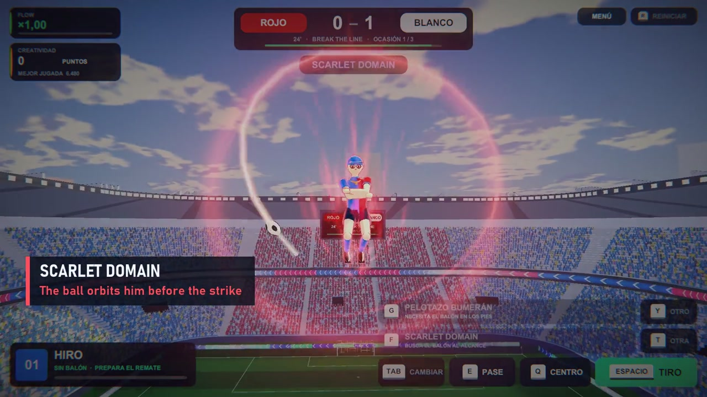

# Miguel Gutiérrez García · Portfolio

Personal portfolio of **Miguel Gutiérrez García**, software engineer & developer.

**Live site:** https://miguelgutierrezgarcia100.github.io/web-miguel-gutierrez/

## Features

- Single-page site, English by default with a Spanish version (EN / ES switch, or `?lang=es`)
- Light and dark themes that follow the system preference
- Responsive layout and accessible markup (keyboard navigation, reduced motion)
- No frameworks or build step: plain HTML, CSS and JavaScript
- Hosted on GitHub Pages

## Structure

```
index.html              page content (EN and ES side by side)
404.html                not-found page
assets/css/styles.css   styles and theme tokens
assets/js/main.js       language switch, theme, menu and scroll effects
assets/img/             photo, favicon and video posters
assets/video/           game trailers
```

## Run locally

```bash
python -m http.server 8000
# open http://localhost:8000
```

## Games

**IE / SOCCER** — Arcade football with custom ball physics, procedural animation,
chainable supertechniques and opponents that react to each play.

[](https://miguelgutierrezgarcia100.github.io/web-miguel-gutierrez/assets/video/iesoccer-trailer-github.mp4)

[Watch trailer](https://miguelgutierrezgarcia100.github.io/web-miguel-gutierrez/assets/video/iesoccer-trailer-github.mp4)

**Blindspot · In development** — A two-player cooperative horror game where you
solve puzzles together to escape a lurking creature.

To add the Blindspot trailer, set `src="assets/video/blindspot-trailer.mp4"` and
`poster="assets/img/blindspot-poster.jpg"` on its `<video>` element in `index.html`
after adding those files. The placeholder disappears when `src` is set.

## Contact

miguelgutierrezgarcia100@gmail.com
